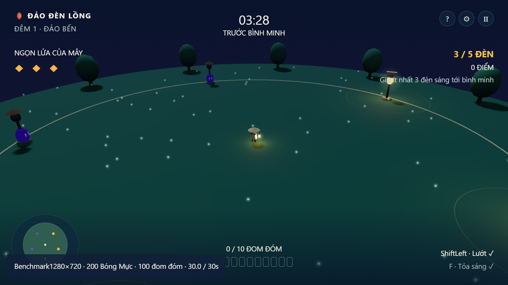

# Đảo Đèn Lồng · v1.0.0

🎬 **[Video demo MP4](docs/demo/demo.mp4)** · [Bằng chứng Phase 4](docs/proof/phase-4/README.md)

Game 3D góc nhìn thứ ba. Cùng **Mây** gom đom đóm, lướt qua ba hòn đảo và giữ đủ
đèn sáng tới bình minh. Có Bóng Mực, Gió Lạc, Bùa Gió, đèn cạn dầu, bảng xếp hạng
cục bộ, đổi phím và các tùy chọn dễ tiếp cận. **Test Contract v1.3**.

Học viên: **Nguyễn Sỹ Huy Kiên · 2A202603641 · K5-L3A**.
Nguồn: [Đảo Đèn Lồng Lab](https://claude.ai/artifact/Q1RYyv1dxjUczzCbd2ZnoW).
Các ticket đã đọc được sau đăng nhập Claude; bản chụp gốc ở `docs/requirements/`.



## Cài và chơi — 3 lệnh

Cần **Node.js22+**, npm và trình duyệt hỗ trợ WebGL2 trên Windows/macOS/Linux.
Benchmark dùng Electron45.4.1; lần đầu có thể cần tải runtime chính thức (~150MB).

```bash
npm ci
npm run build
npm start
```

Mở **http://127.0.0.1:4173**. Mặc định bắt đầu Đêm1; menu cho phép chọn đêm để
khám phá. Sau khi thắng, chọn Đêm kế tiếp; thua thì chơi lại cùng đêm. Thắng Đêm3
hiện Bình Minh. Tổng điểm chỉ tính các đêm đã thắng; chơi lại không cộng trùng.

Bản ZIP trong `release/` có sẵn `dist/` và server: giải nén rồi chạy
`node scripts/serve.mjs`, không cần cài thư viện để chơi. Không mở bằng `file://`.
Server đi kèm cần cho bảng xếp hạng trên đĩa; server tĩnh thông thường chỉ phục vụ bản chơi.

| Phím mặc định | Hành động |
|---|---|
| W / S / A / D | Tiến / lùi / trái / phải theo camera |
| Space | Nhảy |
| Shift trái | Lướt |
| E | Nạp đom đóm / châm dầu cho đèn |
| F | Tỏa sáng, tốn3 đom đóm |
| Q / C hoặc kéo chuột | Xoay camera |
| P / Esc | Tạm dừng / tiếp tục |

Trong **Cài đặt**, đổi tất cả các phím hành động, phát hiện trùng và khôi phục
mặc định. Âm lượng, độ nhạy chuột, bảng màu dễ phân biệt, giảm chuyển động và
chữ lớn được lưu giữa các lần mở game. Q/C dành riêng cho camera.

## Luật hiện hành

- Đêm1/2/3: Đảo Bến/Đảo Cau/Đảo Chuông, 5/6/7 đèn, thời gian240/270/300 giây.
- Chạy6m/s; nhảy7m/s; lướt14m/s trong12tick, hồi90tick. Bục nhảy/gió theo map chuẩn.
- Nhặt tự động trong XZ1m, chênh cao≤1,5m. Sức chứa ban đầu10, mỗi lần thắp thành
  công tăng2, tối đa20. Đèn mới cần10 đom đóm; thắp lại cần5.
- Đèn có100 dầu, tự hao1/s; mỗi đom đóm châm10 dầu. Dầu<30 mất vùng an toàn6m;
  Bóng Mực wander có thể hút thêm5/s mỗi con. Đèn tắt reset tiến độ nạp và nhớ ever_lit.
- Pulse chọn mục tiêu trong3D5m từ chân+0,8m, stun120tick, đẩy4m trong15tick.
  Gió Lạc cướp đom đóm; Bùa Gió tăng chạy7,2m/s và bỏ hồi lướt trong600tick.
- Hết lửa thua ngay. Rơi dướiY=-10 mất1lửa và toàn bộ đom đóm, hồi sinh sau60tick.
- Chỉ xét thắng ở bình minh: còn sống và có ít nhất3/5,4/6,5/7 đèn đang sáng.

Điểm: mỗi đom đóm nạp/châm +5; thắp lần đầu +100, thắp lại +40; pulse mỗi Bóng
Mực +5 tổng, +15 tổng nếu đang drain. Thắng: mỗi đèn sáng +50+floor(dầu), mỗi lửa
còn lại +50. Không thưởng khi nhặt hoặc khi dựng scenario, không thưởng thời gian.

## Kiểm chứng

```bash
npm test
npm run verify
npm run smoke:clean
```

`verify` chạy test thật, build, scenario tính năng, so replay theo byte, chạy đủ thời
lượng3 đêm và lưu TAP/JSONL/hash. Bất cứ bước sai nào trả mã khác0. `smoke:clean`
cài/build/chạy headless trong thư mục trống bằng cache npm, cần đã cài ít nhất1 lần.
CI Ubuntu/macOS được cấu hình; chỉ xác nhận CI xanh sau khi workflow thực sự chạy.

## Headless / benchmark / soak

```bash
node src/cli.mjs --seed 42 --night 1 --ticks 600 --out out.jsonl
node src/cli.mjs --seed 42 --night 2 --scenario docs/proof/phase-4/drifter-scenario.json --inputs docs/proof/phase-4/drifter-inputs.json --ticks 60 --out drifter.jsonl
node scripts/bench.mjs --seed 42 --duration 30 --out bench.json
node --jitless --max-semi-space-size=1 scripts/soak.mjs --seed 7 --nights 10 --out soak.json
```

CLI có `--snapshot-every` (mặc định10), `--night 1|2|3`, scenario/input tùy chọn.
60Hz cố định, không cửa sổ/GPU; tick0 trước input, bước k tạo event/state k+1.
Input sparse giữ trường cũ, nút kích hoạt cạnh false→true. Pause vẫn tăng tick nhưng
không tăng sim_tick. JSONL kết thúc bằng end. Input/scenario sai trả2, lỗi ghi do
quyền/dung lượng trả1, thành công trả0. Chi tiết tuning ở `game.contract.json`.

Benchmark mở cửa sổ1280×720, pixel ratio1 áp dụng cho cả game và bench. Cảnh đúng
200 shade wander,100 motes,3 đèn100dầu; full geometry/shadow/lights. Warmup3s rồi
đo30s bằng thời gian frame thực; p95 dùng nearest-rank; p1 từ1% frame chậm nhất.
Electron cấu hình tắt frame-rate-limit và GPU-vsync. RSS để null vì game web không
đo được RSS tổng renderer/GPU; không thay bằng số JS heap. Số đo thật ở `bench.json`.

Soak chạy10đêm trong một tiến trình, input ngẫu nhiên theo seed, đo RSS hai mốc
đúng đề. Runtime `--jitless --max-semi-space-size=1` giảm tăng trưởng JIT/nursery,
đổi lại chạy chậm hơn; không chèn ballast vào baseline. Crash hoặc RSS>1,2× thì trả1.
Kết quả thật ở `soak.json`. Máy chấm khác có thể có số đo khác.

## Bảng xếp hạng

Sau thua hoặc Bình Minh, nhập tên3–12ký tự `[A-Za-z0-9_]`. Lưu top10 trên đĩa tại
`data/leaderboard.json`, điểm giảm dần, hòa thì thời gian đạt sớm đứng trước.
Không commit dữ liệu người chơi. Có nút Bảng xếp hạng từ menu.

```bash
node scripts/serve.mjs --export-leaderboard out.json
```

## SDLC, bằng chứng và giới hạn

- Tag `phase-1`: PRD-0/v1.0; `phase-2`: số chuẩn/v1.1; `phase-3`: dầu/v1.2;
  Phase4/v1.3 có đo đạc và bàn giao cuối.
- [Kế hoạch](docs/notes/implementation-plan.md), [Phase2](docs/notes/phase-2.md),
  [ADR Phase3](docs/notes/phase-3-adr.md), [Phase4](docs/notes/phase-4.md).
- [Nhật ký AI và retro](docs/notes/ai-log-and-retro.md), [AGENTS](AGENTS.md),
  [CHANGELOG](CHANGELOG.md), [CREDITS](CREDITS.md), [LICENSE](LICENSE).
- Bằng chứng cũ không bị ghi lại. Không có test ẩn giảng viên; không tuyên bố đã đạt
  toàn bộ test ẩn, CI từ xa hoặc mốc giờ buổi lab. Commit/tag dùng thời gian thật.
- GitHub Release cần xác nhận trạng thái từ GitHub; có file local không đồng nghĩa đã publish.
- [Đề lab gốc](docs/lab/README.md), [GUIDE](GUIDE.md), [RULES](RULES.md),
  [SUBMISSION](SUBMISSION.md), [RUBRIC](RUBRIC.md), [CHECKPOINTS](CHECKPOINTS.md).

## Sáng tạo của tôi

Đảo giữa biển mây, minimap, nón lá treo đèn nhỏ, vòng sáng pulse và giai điệu sine
tự tạo. Các chi tiết trang trí không thêm thực thể gameplay hoặc dùng RNG simulation;
benchmark/soak không thêm nhân vật hay hiệu ứng sáng tạo ngoài cảnh chuẩn.
